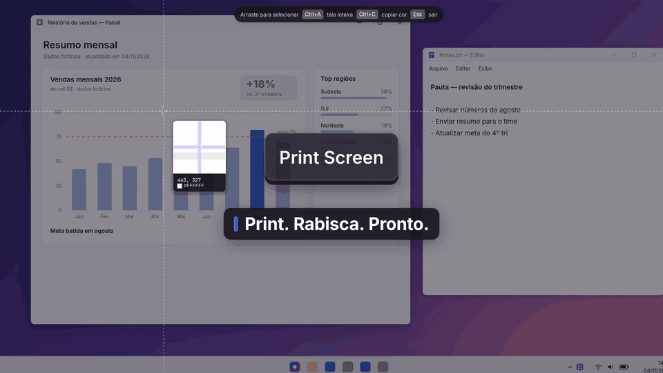
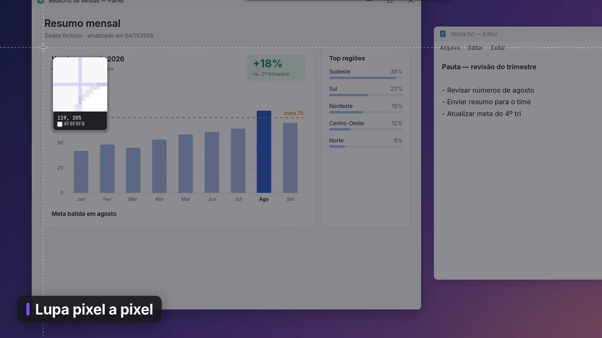
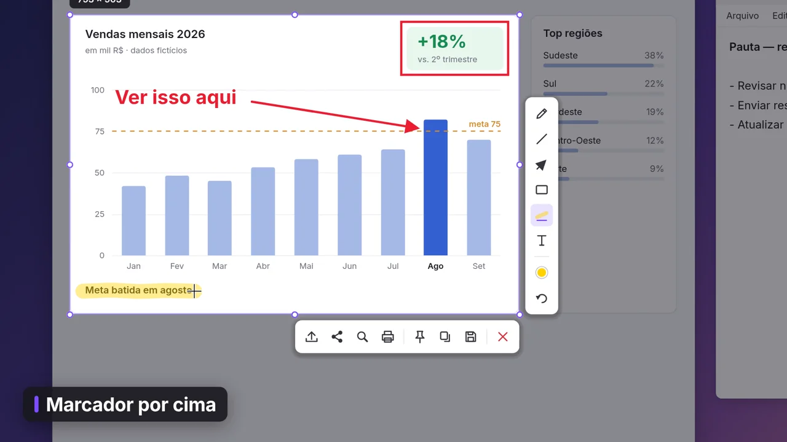
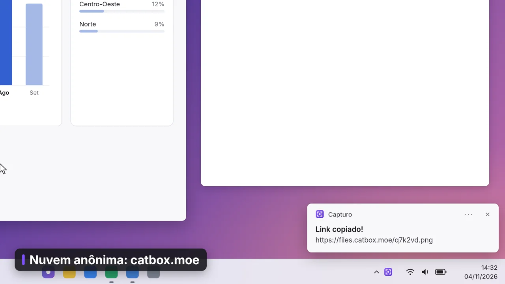
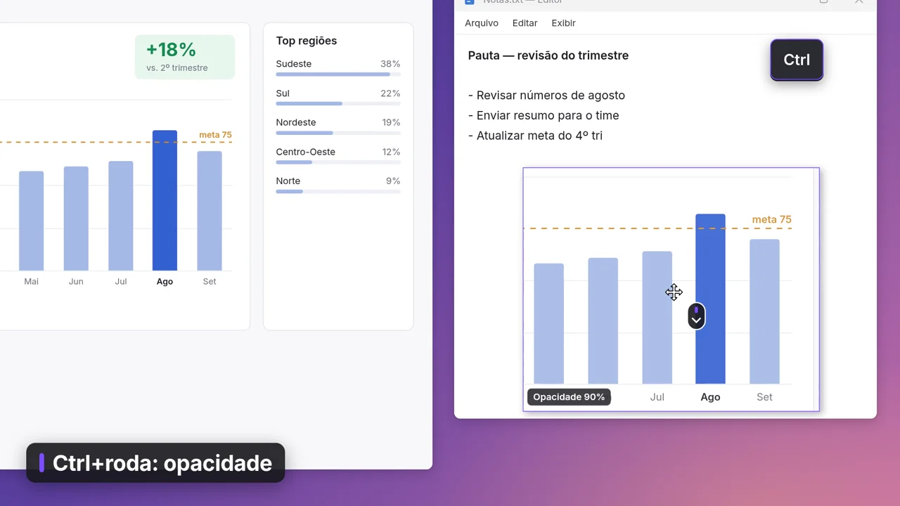
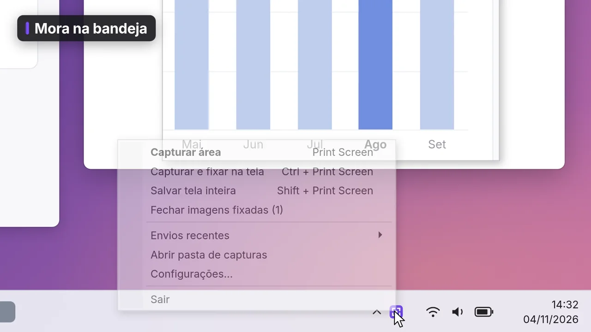
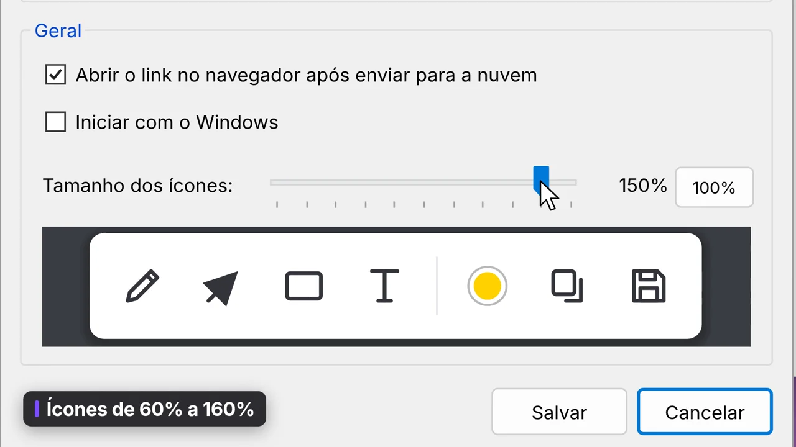

# Capturo

[](docs/media/capturo-demo.mp4)

*[Ver o vídeo completo (40 s, MP4)](docs/media/capturo-demo.mp4)*

Ferramenta de print para Windows no estilo do Lightshot. Fiz porque queria algo pequeno que fizesse só isso e fizesse bem: selecionar uma área, rabiscar em cima e copiar, salvar ou fixar na tela.

É um único `.exe` de menos de 1 MB (a maior parte são os papéis de parede do editor de vídeo), sem instalação e sem dependências. Fica na bandeja do sistema.

## Veja em ação

| | |
|---|---|
|  |  |
| **Print Screen e lupa pixel a pixel** para acertar a seleção. | **Rabisque em cima**: seta, retângulo, texto, marcador e paleta de cores. |
|  |  |
| **Envio pra nuvem** com o link já copiado. | **Fixe a imagem na tela**, com zoom e opacidade. |
|  |  |
| **Menu da bandeja** com todas as ações. | **Configurações**: atalhos, pasta, formato e tamanho dos ícones. |

*O vídeo e as imagens são uma recriação da interface feita a partir do código, não gravações de tela do app rodando. Fonte, notificações do Windows e o conteúdo capturado são aproximados.*

## Stack

C# com WinForms (`src/`: `Program.cs` com o app, `Ocr.cs`, `Gif.cs`, `Recorder.cs`, `Gallery.cs`, `ScrollCapture.cs` (print com rolagem), e para o vídeo `Video.cs` (gravação), `VideoProject.cs` (zoom, câmera, cursor e montagem), `VideoExport.cs`, `VideoEditor.cs`, `Timeline.cs`, `UiKit.cs`, `MediaFoundation.cs`, `Audio.cs`, `ScreenGrab.cs`, `WindowGrab.cs` (gravar uma janela), `Webcam.cs` e `CamFx.cs` (efeitos da webcam)). O vídeo usa o Media Foundation (H.264/AAC) e o WASAPI, que já vêm no Windows. Compila com o `csc.exe` do .NET Framework 4.x que já vem no Windows, então não precisa instalar Visual Studio nem SDK.

## Uso
Rode `dist\Capturo.exe`. Ele fica na bandeja do sistema.

### Atalhos globais (configuráveis em *bandeja → Configurações*)
| Ação | Padrão |
|---|---|
| Capturar área | **Print Screen** (ou clique no ícone da bandeja) |
| Capturar e fixar na tela | **Ctrl + Print Screen** |
| Salvar tela inteira na hora | **Shift + Print Screen** |
| Repetir a última área (abre a captura com ela já selecionada) | sem atalho (defina nas configurações) |
| Print com rolagem | sem atalho (defina nas configurações) |

Pela bandeja também dá para **capturar com atraso** (3, 5 ou 10 s, para pegar menus abertos), fazer um **print com rolagem**, **gravar um vídeo** ou **um GIF** e abrir a **galeria**.
Em *Configurações → Geral → Atraso* dá para fazer o atalho **Capturar área** (e o clique no ícone) sempre esperar 3, 5 ou 10 s antes do print. Esc cancela a contagem.

Para trocar um atalho, clique no campo e pressione a nova combinação. Esc cancela e Backspace deixa o comando sem atalho.
Teclas comuns (letras, números) exigem Ctrl, Alt, Shift ou Win. F1–F24, Print Screen, Pause, Insert e Scroll Lock podem ser usadas sozinhas.

### Durante a captura
| Ação | Atalho |
|---|---|
| Mover o cursor pixel a pixel (com a lupa) | setas |
| Selecionar uma janela inteira (ela fica destacada ao passar o mouse) | clique sem arrastar |
| Copiar a cor do pixel (antes de selecionar) | Ctrl+C |
| Selecionar a tela inteira | Ctrl+A |
| Mover/redimensionar a seleção | arrastar / alças / bordas / setas (Shift+setas redimensiona) |
| Lápis, Linha, Seta, Retângulo, Elipse, Marcador, Texto | P, L, A, R, E, M, T |
| Pixelar área (esconder senha, e-mail, dados) | B |
| Numeração 1, 2, 3… (cada clique põe o próximo número) | N |
| Destaque: escurece tudo fora da área marcada | H |
| Mover e editar anotações (clique para selecionar e arraste; Del apaga; a cor e a roda do mouse mudam a anotação selecionada; duplo clique num texto volta a editar) | V |
| Moldura com sombra na imagem final (liga/desliga e fica lembrado; o estilo fica em *Configurações → Moldura*) | F |
| Paleta de cores | C |
| Tamanho (espessura do traço e da seta, tamanho do texto e dos números). Cada ferramenta guarda o seu | roda do mouse, ou o controle **Tamanho** no painel de cores (C) |
| Linha a 45° / quadrado | segurar Shift ao desenhar |
| Desfazer / Refazer | Ctrl+Z / Ctrl+Y |
| Copiar | Ctrl+C, Enter ou duplo clique |
| Salvar | Ctrl+S |
| **Fixar na tela** | **Ctrl+T** |
| Enviar para a nuvem (copia o link) | Ctrl+D |
| Buscar imagens semelhantes (Google Lens) | Ctrl+G |
| Imprimir | Ctrl+P |
| Selecionar e copiar o texto direto no print (OCR do Windows) | Ctrl+O |
| Gravar GIF da área selecionada | Ctrl+R |
| Gravar vídeo da área selecionada (MP4, com editor de zoom e estilo) | Ctrl+Shift+R |
| Print com rolagem da área selecionada | Ctrl+L |
| Cancelar | Esc / botão direito |

### Imagem fixada
A captura vira uma janela flutuante, **sempre visível por cima** das outras.
- Arrastar move a janela; a roda do mouse dá zoom; Ctrl+roda muda a opacidade.
- `0` volta ao tamanho original. Ctrl+C copia, Ctrl+S salva.
- **Ctrl+T** liga/desliga o "sempre visível". Desligado, a imagem aparece na barra de tarefas.
- Esc ou duplo clique fecha. O botão direito abre um menu com todas as opções.
- *Bandeja → Fechar imagens fixadas* fecha todas de uma vez.

### Copiar texto da imagem (OCR)
Selecione uma área e pressione **Ctrl+O** (ou o botão *Selecionar texto na imagem*). O texto do print fica **selecionável ali mesmo**, como num documento:
- arraste sobre o texto para selecionar (atravessa linhas), duplo clique pega a palavra, triplo clique a linha e **Ctrl+A** tudo;
- **Ctrl+C** (ou Enter) copia a seleção (ou todo o texto, se nada estiver selecionado), mantendo quebras de linha e colunas;
- o botão direito tem *Pesquisar no Google*, *Traduzir* e *Abrir na janela de texto*; Ctrl+O de novo volta às ferramentas de desenho.

Nas **imagens fixadas** o texto também é selecionável: arraste sobre uma palavra para selecionar (fora do texto, o arraste continua movendo a janela) e Ctrl+C copia o texto selecionado.

### Janela de texto
Pelo botão direito no modo texto, pela imagem fixada ou pela galeria (Ctrl+O), o texto abre numa janela própria. A janela abre na hora, com a imagem à esquerda e o texto à direita:
- **Imagem e texto ligados**: clique numa palavra da imagem (ou arraste sobre várias) para selecioná-la no texto; o que você seleciona no texto fica destacado na imagem. Duplo clique numa palavra copia só ela.
- **Formato do texto**: *Linhas* (mantém linhas, parágrafos e colunas separadas por tabulação, que colam certo em planilhas), *Texto corrido* (junta as linhas de cada parágrafo) ou *Uma linha*.
- **Dá para corrigir** o texto antes de copiar.
- **Copiar tudo** (Ctrl+Shift+C), **Copiar seleção** (Ctrl+C), **Pesquisar**, **Traduzir** e **Salvar .txt** (Ctrl+S). Links e e-mails encontrados viram botões para abrir.
- **Idioma**: se houver mais de um idioma de OCR instalado no Windows, troque no botão do topo e o texto é lido de novo.

Abrir o resultado não mexe na área de transferência; só os botões e atalhos copiam. **Esc** fecha.
O reconhecimento usa o OCR do próprio Windows. O Capturo lê a imagem em mais de uma escala, sem suavizar os pixels, estica o contraste de textos claros e corrige enganos comuns (como "RS" em vez de "R$").

### Print com rolagem
Para páginas e listas que não cabem na tela: em *bandeja → Print com rolagem* (ou Ctrl+L com uma área selecionada), clique na janela ou arraste a área. O Capturo rola o conteúdo sozinho com a roda do mouse, fotografa a cada passo e emenda as partes numa imagem longa. Cabeçalhos e rodapés fixos (barra do site, barra do navegador) entram uma vez só, trechos em branco não atrapalham, e menus laterais fixos ficam de fora (a imagem fica só com a parte que rola).
Uma barrinha mostra o andamento. **Concluir** (ou Esc) para e salva o que já foi capturado e **Cancelar** descarta. Enquanto rola, não mexa o mouse: se ele for movido, a rolagem pausa e espera a sua escolha. Ao terminar, a imagem abre na **tela de edição**, com as mesmas ferramentas do print (setas, texto, pixelar, numeração…) e as ações de copiar, salvar, enviar, imprimir e moldura. A roda do mouse (ou arrastar a imagem, PageUp/PageDown, Home/End) rola, Ctrl+roda muda o tamanho do traço e Esc fecha. A captura começa de onde a página está, então role até o topo antes se quiser a página inteira.

### Gravar GIF
Selecione a área e clique no botão de gravar (ou *bandeja → Gravar GIF de uma área* e Enter).
Uma moldura vermelha marca a área e uma barra mostra o tempo, com **Parar** e **Cancelar**; o atalho de captura também encerra.
Grava a 10 quadros por segundo, com o cursor, até 5 minutos. O GIF vai para a pasta de capturas e fica copiado como arquivo, pronto para colar no chat ou no e-mail.

### Gravar vídeo
Abra *bandeja → Gravar vídeo de uma área* (ou o atalho definido em *Configurações → Atalhos*), ou selecione uma área numa captura comum e clique no botão da câmera.
A escolha da fonte segue o estilo do Recordly: passando o mouse, a janela sob o cursor fica destacada em azul com o nome do aplicativo, o título e as medidas. **Clicar numa janela** começa a gravar só ela. **Clicar na área de trabalho** grava a tela inteira daquele monitor. **Arrastar** desenha uma área, que dá para mover e redimensionar antes de gravar com Enter. O botão direito volta para a escolha e o Esc cancela. O mesmo vale para o GIF.
Depois de escolher a fonte, uma moldura azul marca o que vai ser gravado e aparece um **painel de preparação**, com o **microfone**, o **som do computador** e a **webcam** (a setinha escolhe qual câmera, se houver mais de uma), além da **contagem** (sem, 3 s ou 5 s). **Gravar** (ou Enter) começa a contagem e **Cancelar** (ou Esc) desiste. As escolhas ficam salvas para a próxima gravação.
Gravar uma janela usa o Windows Graphics Capture: o vídeo acompanha a janela se ela for movida, e outras janelas por cima ou partes fora da tela não aparecem; se a janela fechar, a gravação termina. Uma contagem de 3 s aparece antes de começar (ajustável no painel de preparação ou nas configurações).
Durante a gravação, a barra mostra o tempo e tem botões para **pausar**, ligar ou silenciar o **microfone** e o **som do computador** (com medidor de nível), ligar ou desligar a **webcam**, **Parar** e **Cancelar**. Cliques na própria barra não entram no vídeo.
Com a **webcam** ligada, uma bolha mostra a câmera durante a gravação (ela não entra na imagem da tela e dá para arrastá-la; onde ela estiver ao parar vira a posição inicial no editor). A câmera é gravada à parte e entra no vídeo pelo editor. A câmera usada fica em *Configurações → Vídeo*.
Grava a 30 ou 60 quadros por segundo, até 5, 10 ou 15 minutos. A tela é copiada pela placa de vídeo (Desktop Duplication, como no OBS): só os quadros que mudaram são gravados, então gravar uma tela quase parada quase não gasta CPU. Se a área cruzar dois monitores, usa a cópia comum do Windows. O cursor não entra na imagem: a posição do mouse e os cliques são guardados à parte e o cursor é redesenhado no editor.

Ao parar, abre o **editor de vídeo** (ou, se preferir nas configurações, o MP4 é exportado direto com o último estilo):
- **Zoom**: os cliques viram trechos de zoom (cliques a até 2,5 s formam um trecho) e, se a opção estiver ligada, também os momentos em que o cursor atravessa a tela e para numa região para trabalhar (ler, digitar, mexer num controle); essas sugestões aparecem num azul mais claro na linha do tempo. O zoom entra rápido e assenta devagar e mira no meio dos cliques do trecho. Se eles estão espalhados, o zoom diminui para todos caberem. A câmera segue o cursor suavizado só quando ele passa da margem segura, empurrando o quadro aos poucos, sem trancos. Trechos próximos deslizam de um ponto ao outro sem sair do zoom. Na exportação, o zoom usa ampliação bicúbica, mais nítida. Profundidade (1,25× a 3×), **duração da animação** (de 0,4 s, bem rápida, a 4 s, bem lenta), **tempo em foco** depois do clique (0,3 s a 8 s) e desfoque de movimento são ajustáveis. Com um tempo de foco longo, zooms seguidos deslizam de um ponto ao outro em vez de sair e entrar.
- **Trechos editáveis** na linha do tempo: clique para selecionar, arraste para mover, puxe as bordas para mudar a duração, duplo clique (ou Z) cria um novo e Del exclui. Com um trecho selecionado, a prévia mostra o enquadramento e dá para arrastar o ponto do zoom; cada trecho tem profundidade própria e pode seguir o cursor ou ficar fixo.
- **Velocidade**: trechos que aceleram (1,5× a 8×) ou desaceleram (0,5×, 0,75×) partes do vídeo, numa faixa própria da linha do tempo (duplo clique ou V cria; arrastar move; as bordas mudam a duração). O som acompanha sem mudar o tom da voz (acima de 4× fica mudo).
- **Câmera**: mostrar ou esconder a webcam, posição (cantos prontos ou arrastando na prévia), tamanho, formato (do quadrado ao círculo), sombra, espelhar e diminuir durante o zoom. Onde a câmera foi desligada na gravação, ela some do vídeo.
- **Efeitos da câmera**: fundo **desfocado** (com intensidade), fundo de **uma cor**, ou **sem fundo** (só a pessoa recortada sobre o vídeo, sem a bolha), filtros (vívido, P&B, sépia, quente, frio), brilho e contorno colorido. A pessoa é separada do fundo pelo modelo MediaPipe Selfie Segmentation (Apache 2.0, em `assets/models`), que roda no próprio computador pelo Windows ML. Nada é enviado para a internet. Os efeitos aparecem na prévia e no vídeo exportado; na exportação, um efeito de fundo deixa cada quadro uns 15 a 30 ms mais lento.
- **Cursor**: tamanho, suavidade, inclinação ao mover, quique no clique, rastro de movimento, sombra e efeito no clique (anel ou onda, com cor).
- **Fundo**: degradês, cores, **papéis de parede prontos** (gerados com o GPT Image e embutidos no app) ou uma imagem sua (com desfoque opcional), margem, cantos arredondados, sombra e formato da tela (original, 16:9, 9:16, 1:1, 4:3).
- **Corte** pelas alças amarelas. Espaço toca com som; Ctrl+Z / Ctrl+Y desfazem e refazem.
- **Exportar**: MP4 (original, 1080p ou 720p; 30 ou 60 fps; três qualidades) ou GIF (largura e fps). O arquivo vai para a pasta de capturas e fica copiado, pronto para colar. Ler o vídeo gravado, montar cada quadro e codificar acontecem ao mesmo tempo, usando todos os núcleos do processador.

A suavidade do cursor olha o movimento para frente e para trás (o vídeo já está gravado), então tira os tremidos e arredonda as curvas sem deixar o cursor atrasado, e nos cliques ele fica exatamente onde clicou. A posição do mouse é gravada a 120 Hz.

Ao fechar sem exportar, dá para **guardar** a gravação e reabrir depois em *bandeja → Gravações não exportadas* (ficam 3 dias em `%LOCALAPPDATA%\Capturo\gravacoes`).

### Galeria
*Bandeja → Galeria de capturas* mostra as últimas 60 capturas que você copiou, salvou, fixou ou enviou. Duplo clique abre; o botão direito copia, fixa, salva ou exclui.
O histórico fica em `%APPDATA%\Capturo\historico` e pode ser desligado nas configurações.

### Linha de comando
`Capturo.exe --capture` inicia uma captura e `Capturo.exe --settings` abre as configurações na instância que já está aberta.

## Upload
O envio usa o **catbox.moe** (anônimo, sem conta). A imagem fica **pública** para quem tiver o link. Os últimos links ficam em *bandeja → Envios recentes*.

## Configurações
Em *bandeja → Configurações → Geral* dá para desligar o histórico da galeria, e o controle **Tamanho dos ícones** aumenta ou diminui as barras de ferramentas da captura (60% a 160%), com prévia ao vivo. Ali também fica o **atraso** antes do print.

Em *Configurações → Moldura* dá para ligar a moldura e escolher o fundo, com prévia ao vivo. Os fundos são cinza claro, branco, escuro, transparente, degradês ou os papéis de parede do editor de vídeo. Também dá para ajustar a margem, os cantos arredondados e a sombra. Com fundo transparente, salve em PNG: a cópia leva a transparência para quem lê PNG da área de transferência (navegadores, Word, Discord).

Os arquivos ficam em `%APPDATA%\Capturo`.

## Compilar
```powershell
./build.ps1
```
O build usa o `csc.exe` que já vem no Windows (.NET Framework 4.x) e os metadados do WinRT em `C:\Windows\System32\WinMetadata` (para o OCR). Não precisa de SDK. O vídeo usa DLLs do próprio Windows (`mfplat`, `mfreadwrite`, WASAPI, `dxgi`/`d3d11`), declaradas no código; a gravação de janela usa o Windows Graphics Capture (Windows 10 1903 ou mais novo) e a webcam o Media Foundation. Os papéis de parede de `assets/wallpapers` são embutidos no `.exe` pelo build.
